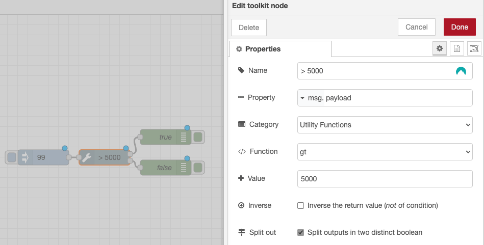

# node-red-contrib-ultimate-toolkit

<h3 align="center">The multi-tool for Node-RED, plus the debug node you wished the native one was.</h3>

<br/>
<p align="center">
  <a href="https://www.npmjs.com/package/@keload/node-red-dxp" aria-label="Build with node-red-dxp">
    
  </a>
</p>
<p align="center">
    <a href="https://github.com/clement-berard/node-red-contrib-ultimate-toolkit/graphs/contributors">
        
    </a>
    <a href="https://github.com/clement-berard/node-red-contrib-ultimate-toolkit/network/members">
        
    </a>
    <a href="https://github.com/clement-berard/node-red-contrib-ultimate-toolkit/stargazers">
        
    </a>
    <a href="https://github.com/clement-berard/node-red-contrib-ultimate-toolkit/issues">
        
    </a>
</p>
<p align="center">
  <a aria-label="NPM Version" href="https://www.npmjs.com/package/@keload/node-red-contrib-ultimate-toolkit">
    
  </a>
  <a aria-label="NPM Download Count" href="https://www.npmjs.com/package/@keload/node-red-contrib-ultimate-toolkit">
    
  </a>
</p>
<table align="center">
  <tr>
    <td align="center">
      <h2>✨ 183</h2>
      <sub><b>Built-in Utilities</b></sub>
    </td>
    <td align="center">
      <h2>🍃 0</h2>
      <sub><b>Runtime Dependencies</b></sub>
    </td>
    <td align="center">
      <h2>🚀 275 kB</h2>
      <sub><b>Bundle Size</b></sub>
    </td>
  </tr>
</table>

## Overview 🔦

✨ Simplify and optimize your Node-RED flows with this versatile package! ✨

Effortlessly handle date formatting, math operations, data manipulation, and more—all **in a single node.**

When needed, the following libraries were used sparingly:
- [es-toolkit](https://es-toolkit.slash.page/)
- [radash](https://radash-docs.vercel.app/docs/getting-started)
- [tempo](https://tempo.formkit.com/)

Whenever possible, native Node.js methods take precedence for maximum efficiency.

**One node to rule them all—streamline your flows like never before!**



## debug-kit 🐞

A second node, **debug-kit**, logs everything about a message in one debug entry, with no configuration: no more `msg.payload` only.

| Section | Content |
| --- | --- |
| `meta` | Node id and name, flow id, `_msgid`, time, delay since the previous message, payload type and size |
| `msg` | The whole message |
| `flow` · `global` · `node` | Every key of the matching context |
| `env` | Process environment variables (off by default, they may hold secrets) |

- Exclude keys (`req,res` by default), limit the depth: circular references, buffers and functions are summarised
- Send the entry to the debug sidebar, the server console, or both
- Optional pass-through output to forward the message unchanged
- Named `debug-kit 1`, `debug-kit 2`... when added, like the native debug node

## Installation 📦

```bash
npm install @keload/node-red-contrib-ultimate-toolkit
```

You can also install it directly from the Node-RED editor via **Manage Palette**.

## Performance 🚀

All used libraries are treeshaked and included in the final bundle.

**No extra dependencies are added.**

## Features ✨


### → Array Utilities

| Name | Description |
| --- | --- |
| `Chunk` | Splits the array into groups of the given size |
| `Compact` | Removes falsy values (0, '', null, undefined, false, NaN) |
| `Count By` | Counts items per property value: {value: count} |
| `Difference` | Returns the items of the array that are not in the other array |
| `Drop` | Removes the first N items |
| `Drop Right` | Removes the last N items |
| `Flatten` | Flattens the array by one level |
| `Flatten Deep` | Flattens the array at every depth |
| `Get Random Item` | Returns one random item, null if the array is empty |
| `Group By` | Groups items into an object keyed by the property value |
| `Head` | Returns the first item, null if empty |
| `Initial` | Returns everything except the last item |
| `Intersection` | Returns the items present in both arrays |
| `Key By` | Maps each item to an object keyed by the property value (last wins) |
| `Last` | Returns the last item, null if empty |
| `Max By` | Returns the item with the highest property value, null if empty |
| `Min By` | Returns the item with the lowest property value, null if empty |
| `Order By` | Sorts objects by the property, ascending or descending |
| `Partition` | Splits into [truthy, falsy] arrays based on the property |
| `Sample Size` | Returns N random items, without repeats |
| `Shuffle` | Returns a randomly reordered copy of the array |
| `Sort By` | Sorts objects by the property, ascending |
| `Sort Natural` | Sorts strings or numbers in natural order: item2 comes before item10, case is ignored |
| `Tail` | Returns everything except the first item |
| `Take` | Returns the first N items |
| `Take Right` | Returns the last N items |
| `Toggle` | Adds the item if absent, removes it if present |
| `Union` | Returns the unique items of both arrays |
| `Unique` | Removes duplicates, by property value or by simple value if empty |
| `Unzip` | Regroups tuples by position: [[1,'a'],[2,'b']] → [[1,2],['a','b']] |
| `Windowed` | Returns sliding windows of the given size: [1,2,3] with 2 → [[1,2],[2,3]] |
| `Zip` | Pairs the items of both arrays by position: [[a1, b1], [a2, b2]] |

### → Async Utilities

| Name | Description |
| --- | --- |
| `Delay` | Delays the message by the specified amount of time |

### → Crypto Utilities

| Name | Description |
| --- | --- |
| `Base64 Decode` | Decodes a base64 or base64url string to text |
| `Base64 Encode` | Encodes a string or a Buffer to base64 (or base64url) |
| `Decrypt` | Decrypts a base64 string made by Encrypt, with the same key |
| `Encrypt` | Encrypts text with AES-256-GCM, the key is a secret read from env, flow or global. Returns a base64 string |
| `Hash` | Returns the digest of a string or a Buffer (md5 and sha1 are not safe for security) |
| `Hex Decode` | Decodes a hexadecimal string to text |
| `Hex Encode` | Encodes a string or a Buffer to hexadecimal |
| `Hmac` | Returns the HMAC of a string or a Buffer, signed with a secret key |
| `Jwt Decode` | Decodes the header and the payload of a JWT. The signature is NOT verified |
| `Random Bytes` | Generates cryptographically secure random bytes, the payload is ignored |
| `Random Int` | Generates a cryptographically secure random integer from Min (included) to Max (excluded), the payload is ignored |
| `Random U U I D` | Generates a random UUID v4, the payload is ignored |
| `Timing Safe Equal` | True if the payload equals the compared value, in constant time (secrets, tokens, signatures) |

### → Date Utilities

| Name | Description |
| --- | --- |
| `Add` | Adds a duration to the date (negative amount to subtract), returns an ISO 8601 date |
| `Age` | Returns the whole years between the date (a birth date) and the reference date |
| `Current Timezone` | Returns the current timezone |
| `Day Of Year` | Returns the day number in the year (1 to 366) |
| `Diff` | Returns the whole units between the date and the reference date (negative if the date is before) |
| `End Of` | Returns the end of the minute, hour, day, week (Sunday), month or year, as an ISO 8601 date |
| `Format` | Return formatted date from a date |
| `Format Relative` | Describes the date relative to the reference date: 'in 3 hours', '2 days ago', 'yesterday' |
| `Is After` | True if the date is after the reference date |
| `Is Before` | True if the date is before the reference date |
| `Is Future` | True if the date is in the future |
| `Is Past` | True if the date is in the past |
| `Is Weekend` | True if the date is a Saturday or a Sunday |
| `Month Days` | Returns the number of days in the month of the date |
| `Now` | Returns the current date with lot of formatting options |
| `Same Day` | True if the date is on the same day as the reference date |
| `Start Of` | Returns the start of the minute, hour, day, week (Monday), month or year, as an ISO 8601 date |
| `Time Range` | Routes messages depending on the time |

### → Math Utilities

| Name | Description |
| --- | --- |
| `Abs` | Returns the absolute value |
| `Acos` | Returns the arccosine, in radians |
| `Asin` | Returns the arcsine, in radians |
| `Atan` | Returns the arctangent, in radians |
| `Ceil` | Rounds up to the next integer |
| `Clamp` | Restricts the number between Min and Max |
| `Cos` | Returns the cosine of an angle in radians |
| `Exp` | Returns e raised to the power of the number |
| `Floor` | Rounds down to the previous integer |
| `In Range` | True if the number is greater than or equal to Min and lower than Max |
| `Log` | Returns the natural logarithm (base e) |
| `Max` | Returns the largest value of the array |
| `Mean` | Returns the average of the array |
| `Median` | Returns the median of the array |
| `Min` | Returns the smallest value of the array |
| `Random` | Returns a random number from 0 (included) to 1 (excluded) |
| `Round` | Rounds to the nearest integer |
| `Round To` | Rounds to the given number of decimals |
| `Sin` | Returns the sine of an angle in radians |
| `Sum` | Returns the sum of the array |
| `Tan` | Returns the tangent of an angle in radians |
| `Trunc` | Removes the decimal part |

### → Network Utilities

| Name | Description |
| --- | --- |
| `Ip Information` | Fetches detailed information about an IP address |
| `Ip Version` | Returns IP version (4, 6, or 0 if invalid) for a given IP address string |
| `Network Interfaces` | Lists all network interfaces of the current machine (ethernet, wifi, etc.) |

### → Object Utilities

| Name | Description |
| --- | --- |
| `Clone Deep` | Returns a deep copy, independent from the original |
| `Construct` | Rebuilds nesting from dot paths: {'a.b':1} → {a:{b:1}} |
| `Find Key` | Returns the first key holding this value, null if none |
| `Flatten Object` | Flattens nested keys to dot paths: {a:{b:1}} → {'a.b':1} |
| `Get` | Reads a value by path like <code>a.b[0].c</code>, null if missing |
| `Get Keys` | Returns the keys of the object as an array |
| `Invert` | Swaps keys and values: {a:'x'} → {x:'a'} |
| `Listify` | Converts the object to an array of {key, value} |
| `Lowerize` | Converts keys to lower case |
| `Merge` | Deep merges the other object into the object, the other object wins. Returns a new object |
| `Omit` | Removes the listed keys (comma separated) |
| `Pick` | Keeps only the listed keys (comma separated) |
| `Set` | Sets a value at a path (a.b[0].c), creating what is missing. Returns a new object |
| `Shake` | Removes keys whose value is undefined |
| `Sort Keys` | Returns the object with keys sorted alphabetically |
| `To Camel Case Keys` | Converts keys to camelCase, deeply |
| `To Constant Case Keys` | Converts keys to CONSTANT_CASE, deeply |
| `To Kebab Case Keys` | Converts keys to kebab-case, deeply |
| `To Pascal Case Keys` | Converts keys to PascalCase, deeply |
| `To Snake Case Keys` | Converts keys to snake_case, deeply |
| `Upperize` | Converts keys to upper case |

### → Parsers

| Name | Description |
| --- | --- |
| `JSON` | Converts between a JSON string and an object, like the native json node |
| `Query String` | Converts between a query string and an object: 'a=1&b=2&b=3' ⇄ {a: '1', b: ['2', '3']} |
| `URL` | Converts between a URL string and an object (protocol, hostname, port, pathname, query, hash...) |

### → Predicates

| Name | Description |
| --- | --- |
| `Is Array` | True if the value is an array |
| `Is Boolean` | True if the value is a boolean |
| `Is Buffer` | True if the value is a Buffer |
| `Is Date` | True if the value is a Date object |
| `Is Empty` | True if the value is an empty string, array, object, or zero-like value |
| `Is Empty Object` | True if the value is an object without any key |
| `Is Equal` | Deep comparison with a value, parsed as JSON or kept as text if not valid JSON |
| `Is Error` | True if the value is an Error object |
| `Is Float` | True if the value is a non-integer number |
| `Is Int` | True if the value is an integer |
| `Is Ip` | True if the value is a valid IPv4 or IPv6 address |
| `Is JSON` | True if the value is a string holding valid JSON |
| `Is NaN` | True if the value is NaN |
| `Is Nil` | True if the value is null or undefined |
| `Is Not Nil` | True if the value is neither null nor undefined |
| `Is Null` | True if the value is null |
| `Is Number` | True if the value is a number |
| `Is Plain Object` | True if the value is a plain object ({}), not an array or class instance |
| `Is Primitive` | True if the value is a primitive (string, number, boolean, null, undefined, symbol, bigint) |
| `Is String` | True if the value is a string |
| `Is Undefined` | True if the value is undefined |
| `Is Url` | True if the value is a valid URL |

### → String Utilities

| Name | Description |
| --- | --- |
| `Camel Case` | Converts to camelCase: foo bar → fooBar |
| `Capitalize` | Uppercases the first letter, lowercases the rest |
| `Constant Case` | Converts to CONSTANT_CASE: foo bar → FOO_BAR |
| `Deburr` | Removes accents: crème brûlée → creme brulee |
| `Dedent` | Removes the common leading indentation of every line |
| `Escape` | Escapes HTML characters (&, <, >, quotes) |
| `Escape Reg Exp` | Escapes regex special characters so the text can be used literally in a RegExp |
| `Kebab Case` | Converts to kebab-case: foo bar → foo-bar |
| `Lower Case` | Converts to lower case words separated by spaces: fooBar → foo bar |
| `Lower First` | Lowercases the first letter only |
| `Pad` | Centers the text with spaces up to the given length |
| `Pascal Case` | Converts to PascalCase: foo bar → FooBar |
| `Reverse String` | Reverses the characters of the text |
| `Sentence Case` | Converts to a sentence: fooBar → Foo bar |
| `Snake Case` | Converts to snake_case: foo bar → foo_bar |
| `Start Case` | Converts to Start Case: fooBar → Foo Bar |
| `Title` | Capitalizes each word: hello world → Hello World |
| `Trim` | Removes whitespace at both ends |
| `Trim End` | Removes whitespace at the end |
| `Trim Start` | Removes whitespace at the start |
| `Unescape` | Reverses escape: &amp; → & |
| `Upper Case` | Converts to UPPER CASE words separated by spaces: fooBar → FOO BAR |
| `Upper First` | Uppercases the first letter only |
| `Words` | Splits the text into an array of words |

### → Tools

| Name | Description |
| --- | --- |
| `Cyclic Counter` | A customizable cyclic counter node for Node-RED that iterates through a defined sequence of numbers and can reset after a set timeout. It allows flexible control over the counter's behavior, making it useful in a variety of automation scenarios. |

### → Unit Utilities

| Name | Description |
| --- | --- |
| `Format Bytes` | Formats a number of bytes: 1536 → '1.5 KB' |
| `Format Duration` | Formats a duration in seconds or milliseconds: 3661 → '1h 1m 1s' |
| `Parse Duration` | Reads a duration text in seconds or milliseconds: '1h 30m' → 5400. Units: d, h, m, s, ms |
| `Speed` | Converts a speed between m/s, km/h, mph and knots |
| `Temperature` | Converts a temperature between °C, °F and K |

### → Utility Functions

| Name | Description |
| --- | --- |
| `Cast Array` | Wraps the value in an array unless it already is one |
| `Default To` | Returns the value if set, otherwise the fallback (null, undefined and NaN are replaced). Fallback is read as JSON or text |
| `Eq` | True if the payload equals the value (SameValueZero, so NaN equals NaN) |
| `Gt` | True if the payload is greater than the value |
| `Gte` | True if the payload is greater than or equal to the value |
| `Lt` | True if the payload is lower than the value |
| `Lte` | True if the payload is lower than or equal to the value |
| `Size` | Returns the length of an array or string, or the key count of an object |
| `To Array` | Converts a value, string or object to an array |
| `To Boolean` | Converts to true or false based on truthiness |
| `To Boolean Number` | Returns 1 if the value is falsy, 0 if truthy |
| `To Finite` | Converts to a finite number: Infinity becomes the max number, NaN becomes 0 |
| `To Integer` | Converts to an integer, truncating decimals |
| `To Number` | Converts the value to a number (NaN if not convertible) |
| `toNumber (non-strict)` | Converts to a number, returns the original value if not convertible |
| `To Safe Integer` | Converts to an integer clamped to the safe integer range |
| `To String` | Converts the value to a string (null and undefined become an empty string) |
| `Uid` | Generates a random id, the payload is ignored |


## Contributing & Developer Experience
This package is built using [node-red-dxp](https://www.npmjs.com/package/@keload/node-red-dxp), offering a blazing-fast and seamless way to develop Node-RED packages. 

Written in **TypeScript**, the codebase is cleanly structured, ensuring maintainability and effortless scalability.

We’re committed to keeping this node alive and thriving, making it a joy to evolve and improve over time. Whether it's refining existing features or adding new capabilities, contributing should always be an enjoyable experience.

Feel free to join the journey—create issues, submit pull requests, or share your ideas. Let’s build something incredible together!

## License

MIT
